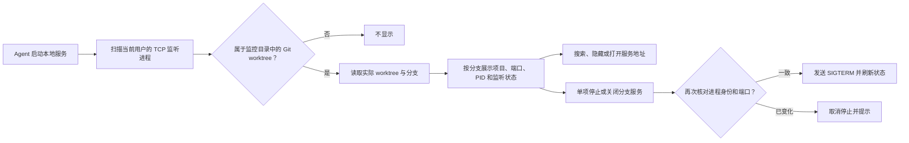

<p align="center"></p>

# KMonitor

**心天之眼，识别每个本地服务所在的分支。**

KMonitor 是一款 macOS 原生应用，面向同时用 Agent 在多个 Git worktree 开发、启动服务的人。它扫描当前用户的 TCP 监听进程，从实际工作目录读取 Git 分支，在一个面板中查看并手动停止服务。应用名称沿用项目名 KMonitor；形象是一只“心天之眼”守望妖怪。

## 首版功能

- 以真实监听进程为准，自动发现主目录下 Git 工作区中的服务，按分支分组；默认排除 Homebrew 等系统目录。
- 显示 worktree、进程名、PID、端口和监听地址；每秒自动刷新，可搜索，也可从菜单栏手动刷新；分支组可点击折叠。
- 可选择工作区目录过滤；可隐藏不需要看的服务并随时恢复。
- 从菜单栏快速查看服务数量并打开主面板。
- 打开本地地址，或在再次确认进程归属后停止单个服务；分支标题右侧可关闭当前分支中显示的服务。

## 功能描述（Mermaid）



完整边界与验收场景见 [首版规划](docs/PLAN.md)。

## 构建

需要 macOS 15+ 与 Xcode 27 或兼容的 Swift 6.2+ 工具链。

```bash
swift test --disable-sandbox
./Scripts/build-app.sh
open .build/app/KMonitor.app
```

项目不依赖第三方运行库。`lsof` 与 `git` 使用 macOS 上的系统命令。首次打开时会自动发现当前用户在主目录下开发 worktree 中启动的监听进程；其他目录可手动选择。

## 安装到当前 Mac

退出正在运行的 KMonitor 后，将构建好的应用复制到系统“应用程序”目录：

```bash
ditto .build/app/KMonitor.app /Applications/KMonitor.app
open /Applications/KMonitor.app
```

## 使用说明

1. 启动由 Codex 或其他 Agent 开发的本地服务。
2. 打开 KMonitor，在分支分组下核对服务所在 worktree 和端口。
3. 点击分支标题可折叠服务。需要停止时点单项“停止”或分支右侧“关闭分支服务”，核对弹窗内容；KMonitor 会对每个目标再次核对 PID、用户、worktree 和端口。

如果某服务被父进程或进程管理器自动重启，它会在刷新后重新出现。KMonitor 不会自动强制杀进程。端口监听只说明进程在提供连接，不代表业务接口健康。

## 文档

- [首版规划](docs/PLAN.md)
- [开发状态](docs/STATUS.md)
- [验证记录](docs/TEST_REPORT.md)

作者：范显
